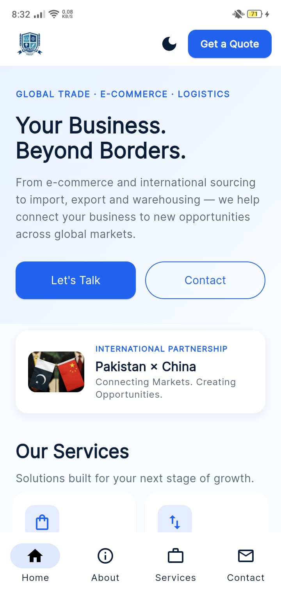
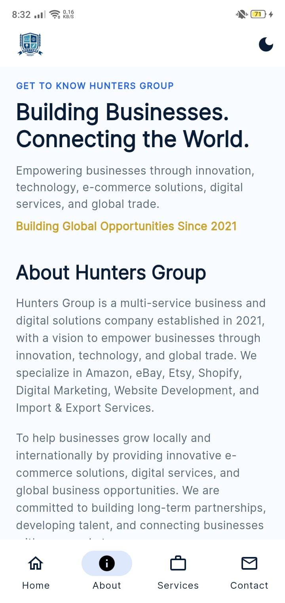
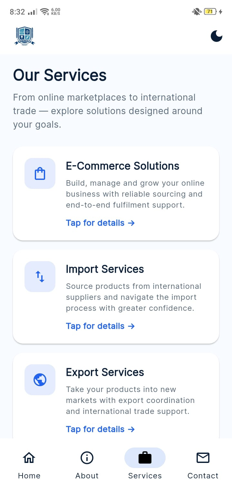
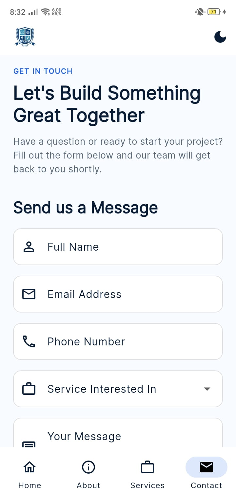
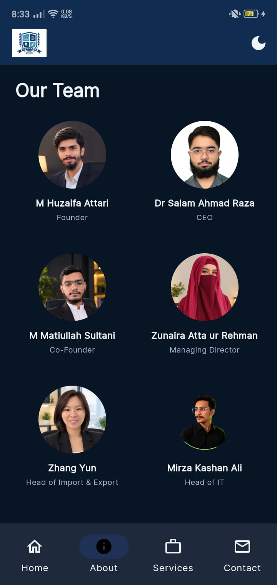

# Hunters Group — Official Mobile Application

A professional cross-platform mobile application developed for **Hunters Group** using Flutter and Dart. The application provides a modern mobile experience for exploring company information, business services, corporate credentials, and leadership profiles.

<p align="center">
  
  
  
  
</p>

---

## Project Overview

Hunters Group operates across international business services, with a focus on China–Pakistan trade, sourcing, import, export, logistics, and digital solutions.

This application brings the company's digital presence to mobile through a structured, responsive, and user-friendly interface.

**Official Website:** [huntersgroup.agency](https://www.huntersgroup.agency/)

### Key Objectives

- Establish a professional mobile presence for Hunters Group.
- Maintain consistency with the company's official branding.
- Present business services and corporate information clearly.
- Deliver an intuitive and responsive user experience.
- Provide convenient access to company contact information.

---

## Features

- **Modern UI/UX:** Professional interface aligned with the company's visual identity.
- **Four-Screen Navigation:** Home, About Us, Services, and Contact.
- **Theme Support:** Light and dark application themes.
- **Services Showcase:** Six business service categories with interactive detail sections.
- **Company Profile:** Company background, mission, vision, and corporate credentials.
- **Leadership Profiles:** Company leadership information with photographs and designations.
- **Contact Form:** Structured inquiry form with input validation.
- **Responsive Design:** Layouts adapted to different mobile screen sizes.
- **Reusable Components:** Consistent UI elements and organized application code.
- **Error Handling:** Appropriate image and interaction fallbacks.

---

## Application Screens

| Screen | Description |
|---|---|
| **Home** | Company introduction, hero section, Pakistan–China banner, services overview, business highlights, and process sections. |
| **About Us** | Company background, mission, vision, corporate registrations, and leadership profiles. |
| **Services** | Overview of the company's six core business services with interactive details. |
| **Contact** | Customer inquiry form and company contact information. |

---

## Business Services

The application presents the following services:

| Service | Overview |
|---|---|
| E-Commerce Solutions | Digital commerce and online business solutions. |
| Import Services | Import facilitation and international sourcing. |
| Export Services | International trade and export support. |
| Logistics & Shipping | Logistics coordination and shipping solutions. |
| Buyer & Sourcing Support | Product sourcing and supplier assistance. |
| Web Development | Website development and digital solutions. |

---

## Company Leadership

| Name | Designation |
|---|---|
| M Huzaifa Attari | Founder |
| Dr Salam Ahmad Raza | Chief Executive Officer |
| M Matiullah Sultani | Co-Founder |
| Zunaira Atta ur Rehman | Managing Director |
| Zhang Yun | Head of Import & Export |
| Mirza Kashan Ali | Head of IT |

*Company information referenced from the official Hunters Group website.*

---

## Technology Stack

| Category | Technology |
|---|---|
| Framework | Flutter |
| Programming Language | Dart |
| UI Framework | Material Design |
| State Management | Flutter Stateful Widgets |
| Typography | Google Fonts |
| External Navigation | URL Launcher |
| Vector Graphics | Flutter SVG |
| Icons | Material & Cupertino Icons |
| Code Quality | Flutter Lints |
| Testing | Flutter Test |

---

## Project Structure

```text
hunters_group/
│
├── android/
├── ios/
├── assets/
│   └── images/
│
├── lib/
│   ├── main.dart
│   │
│   ├── data/
│   │   └── app_data.dart
│   │
│   ├── screens/
│   │   ├── home_screen.dart
│   │   ├── about_screen.dart
│   │   ├── services_screen.dart
│   │   └── contact_screen.dart
│   │
│   └── widgets/
│       ├── benefit_card.dart
│       ├── service_card.dart
│       ├── service_bottom_sheet.dart
│       ├── section_header.dart
│       ├── registration_item.dart
│       ├── process_step.dart
│       └── custom_app_bar.dart
│
├── test/
│   └── widget_test.dart
│
├── pubspec.yaml
├── analysis_options.yaml
└── README.md
```

---

## Getting Started

### Prerequisites

- Flutter SDK (stable channel).
- Dart SDK compatible with the project configuration.
- Android Studio or Visual Studio Code.
- Android emulator or physical Android device.

### Installation

Clone the repository and install the required dependencies:

```bash
git clone <repository-url>
cd hunters_group
flutter pub get
```

### Run the Application

```bash
flutter run
```

---

## Build

### Android Release APK

```bash
flutter build apk --release
```

**Output:**

```text
build/app/outputs/flutter-apk/app-release.apk
```

### Android App Bundle

```bash
flutter build appbundle --release
```

---

## Testing & Code Quality

The application can be checked using Flutter's built-in analysis and testing tools.

**Static Analysis**

```bash
flutter analyze
```

**Automated Tests**

```bash
flutter test
```

---

## Developer

**Maira Sarwar**

Mobile Application Developer | Flutter & Dart

Lahore, Pakistan

- **GitHub:** [mairasarwar132](https://github.com/mairasarwar132)
- **LinkedIn:** [Professional Profile](https://linkedin.com/in/maira-sarwar-771231416)
- **Portfolio:** [mairasarwar132.github.io](https://mairasarwar132.github.io/)
- **Email:** mairasarwar132@gmail.com

---

## Acknowledgements

Special acknowledgement to **Hunters Group** for the company information, branding references, and project requirements.

**Official Website:** https://www.huntersgroup.agency/

---

## App Screenshots

Below are the actual screenshots of the Hunters Group Flutter application, captured from the running app:

### Home Screen


### About Screen


### Services Screen


### Contact Screen


### Navigation Menu


---

<p align="center">
  <strong>Hunters Group — Official Mobile Application</strong>
  <br>
  Developed with Flutter & Dart
</p>
